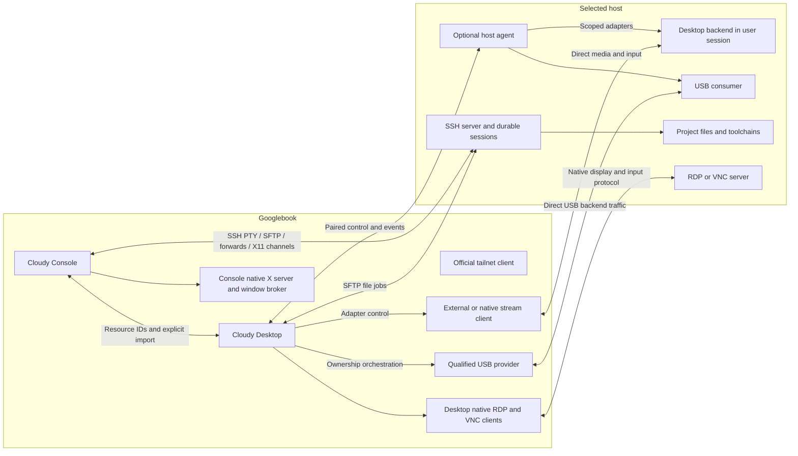

# Proposed system architecture

The execution host owns compute and project files. Googlebook owns interaction, local user choices, and per-app credentials. Direct backend paths carry media, USB, and files; the optional host control plane carries capabilities, scoped requests, and events.

Both clients are Android packages designed for the Googlebook desktop ecosystem under [Rule 0](../00-project/platform-rule-zero.md). Native tasks/windows and platform lifecycle are the client foundation; phone/tablet optimization is outside scope.

Tailnet connectivity protects routing but does not replace SSH host verification or application pairing. The diagram's lines may share a VPN interface; they do not share a UI bridge or central relay implemented by Cloudy.

## Client composition

Each app has a native activity/window shell, app-specific state coordinator, per-app credential/profile store, bounded background connection components, and shared source libraries. Window objects own view state, not durable remote work. The renderer is a local terminal surface; stream/RDP/VNC/X11 rendering uses native engine surfaces. No video frames or bulk terminal/file data travel through general-purpose JSON UI messages.

Propose Kotlin/Compose for windowing, semantics, focus, native pickers, and theme adaptation. Prototype xterm.js in a dedicated locally bundled WebView with a typed narrow bridge. The renderer does not get raw credentials, arbitrary host RPC, or browsing ability. This differs from the original all-React shell and remains contingent on P0 input/accessibility evidence.

## Host composition

The optional host core offers pairing, version/capability negotiation, request authorization, managed jobs, event cursors, and diagnostics. A logged-in user adapter owns session-sensitive operations. A narrow privileged helper is added only for a demonstrated installation/device operation. Desktop streaming and ordinary SSH remain separately installed/backed services during initial releases.

Capabilities describe actual OS/session/backend facts: installed and running are distinct; capture authorized and capture working are distinct. Include host installation, boot, and user-session identities so reconnect cannot mistake a new session for an old one.

## Control and data boundaries

| Plane | Payload | Trust / lifetime |
| --- | --- | --- |
| Console data | SSH byte channels, SFTP, forwards | Host-key trust and per-app credentials |
| Console graphical apps | SSH X11 channels → local X server → native window broker | Per-trust-context display/authentication; GUI lifetime distinct from tmux |
| Desktop media | Backend video/audio/input | Backend-specific pairing and native transport |
| RDP / VNC | Native protocol display/input and negotiated channels | Per-protocol server trust/authentication; no automatic protocol/session substitution |
| USB data | Provider↔consumer backend | Exact device/owner and protected-operation policy |
| File jobs | SFTP/provider streams | Version checks, bounded staging, destination permissions |
| Host control | Capabilities, idempotent scoped requests | Explicit pairing, authenticated transport, expiration |
| Events | Ordered host/job/activity records | Cursor, boot/stream identity, bounded replay |
| Cross-app navigation | Registered resource identifiers | Signature-protected IPC plus receiver validation |

## Initial deployment

Baseline SSH needs Console, an SSH server and a route. Full R1 adds the qualified local X server/broker, remote X11 prerequisites and integrated SFTP. R2 adds Desktop's native RDP/VNC, qualified external stream backend, files and enrolled USB provider/consumer topology. R3 adds the custom host agent where useful; R4 qualifies native high-performance streaming. Discover host OS/session/backend support rather than hard-coding model names. See [X11](x11-windows.md), [files](console-files.md), [desktop clients](remote-desktop-backends.md) and [USB](usb-plug-and-play.md).
