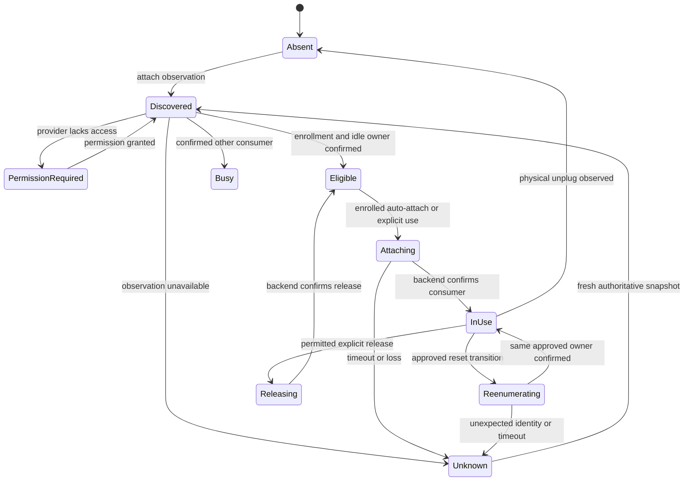

# USB forwarding with enrolled plug-and-play

**Status:** required product workflow, backend-dependent implementation. **Stages:** P0-S5, P3-S4/P3-S6. **Cases:** Q-D04/Q-D06. Googlebook provides a locally attached device; one approved workstation consumes it through a qualified USB backend.

## Experience contract

First use enrolls the device, destination host/workspace, provider/consumer, required Android permission, host driver, and auto-attach preference. After setup, plugging in a recognized idle device should discover it, check actual ownership and permission, attach it to its enrolled host, and show the resulting consumer/tool readiness without repeated Cloudy dialogs. A quiet notification or persistent Devices row reports Ready, permission required, busy, or unavailable with a concrete next action.

Plug-and-play is the normal qualified path after enrollment, not a promise to bypass Android consent or install arbitrary host drivers silently. Permissions, OS policy, vendor licensing, an absent consumer, and unsupported hardware can still require setup. Unplug/replug and firmware reenumeration are part of the core workflow, not exceptional UI polish.

## Provider, orchestrator, and consumer

Android [USB host APIs](https://developer.android.com/develop/connectivity/usb/host) describe enumeration, attach/detach and permission. They are not a USB-over-network virtualization backend. If VirtualHere owns access, its Android provider requests/holds permission; Cloudy must not claim the same interface concurrently or assume Cloudy's permission grant transfers to that app. P0 must establish what provider observations/control are actually exposed.

[VirtualHere Android server](https://www.virtualhere.com/android) and a matching workstation consumer are the first candidate. Its [client API](https://www.virtualhere.com/client_api) documents `GET CLIENT STATE`, `DEVICE INFO`, `USE`, `STOP USING`, and device/port auto-use commands. The API controls the **running consumer**; it does not establish an Android server-control API or a Googlebook driver. A narrow authenticated host-side adapter can invoke it; the optional Cloudy host agent is one implementation, not a prerequisite for ordinary SSH/RDP/VNC.

Pin backend versions and verify their installed `HELP`, state format, command results, and permission/control scope. Auto-use commands documented as on/off toggles are not idempotent setters: read the state, apply only a needed change, and reconcile after an ambiguous response. An API timeout can leave completion unknown. An `OK` is not a substitute for confirming which consumer owns which device.

## Enrollment identity and policy

| Record | Required meaning |
| --- | --- |
| Provider | Stable approved provider identity and reachable endpoint; not a changing display label |
| Device identity | VID/PID, interface/class, serial when available, backend identity, optionally explicit physical-port binding |
| Reenumeration aliases | Approved runtime/bootloader/DFU identity set for the exact board/tool workflow; not all devices of a VID/PID |
| Consumer | One enrolled host/backend identity; no auto-selection from whichever workspace currently has focus |
| Auto-attach | Disabled, enrolled device, or enrolled device+port policy; visible and reversible |
| Protection | Known programming operation and owner; uncertainty preserves protection until reconciliation |
| Audit state | Observation time, connection generation, last confirmed owner, result/error, and effective policy |

Absent/non-unique serials weaken identity. Enroll the actual physical port/topology or keep manual approval; show the limitation. Do not auto-claim every device on a hub by default. Host selection changes do not steal a device from another host. Backend-wide auto-use rules must be reconciled so two consumers cannot race Cloudy's intended policy.

## State machine

Physical unplug closes that connection generation; it does not prove a protected job succeeded or that a remote tool released every handle. Clear stale device handles and reconcile the consuming tool/backend. Avoid fast duplicate attach loops by debouncing events and using generation-scoped requests with bounded retry. Restart restores enrollment intent, then queries live state before acting.

Only an enrolled, permissioned device with confirmed idle ownership is eligible for automatic attachment to its approved consumer. Reattaching an approved bootloader identity to the same owner may be allowed by the backend and protection policy; this **never** replays a flash/program command. Unknown ownership, active programming, an unexpected identity, or a competing host prevents automatic reassignment. Lease expiry is not physical release.

## Stage acceptance and support labels

P0-S5 proves an actual flash/verify workflow and investigates hotplug/API/permission behavior. P3-S4 implements ownership/protection. P3-S6 adds enrollment and the complete plug/unplug/replug path. Qualify repeated cycles, first permission, denial/revocation, app/consumer restart, network loss, host offline, two-host contention, stale snapshots, absent serial, composite device, and approved/unapproved bootloader changes.

Proposed normal-path target: ready within 5 s after permission, provider discovery, route and consumer are available; record OS/driver startup separately and report p50/p95 over at least 30 cycles. This is a target, not a current VirtualHere/Googlebook guarantee. Publish support by exact device/tool/firmware and topology. Passing serial data does not certify JTAG, DFU, storage, audio, or isochronous devices. If forwarding fails, qualify a lab-side provider/hardware server as a different topology and state that local Googlebook plug-and-play remains unmet.
