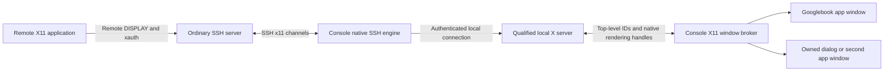

# Console X11 forwarding and separate application windows

**Status:** required product behavior, proposed implementation. **Stages:** P0-S7 and P2-S6. **Cases:** Q-C07/Q-C08. Console remains independently useful with an ordinary SSH server; Desktop and the custom host agent are not prerequisites.

## User workflow

Enable X11 forwarding in a Console host/session profile, connect through verified SSH, then launch a remote X11 application from that shell. Its top-level window appears as a separate Googlebook desktop window with native move/resize/minimize/maximize and task-switching behavior. Console lists the associated graphical windows and can focus them without embedding them in a terminal tab. Closing one window requests closure of that app window, not the SSH workspace or sibling apps.

The [MobaXterm manual](https://mobaxterm.mobatek.net/documentation.html) is the interaction reference for its multiwindow mode. A separate full X desktop inside one Android window may be a useful diagnostic mode, but does not meet the requested per-application window gate.

## Proposed path and ownership

The SSH engine implements the standard `x11-req` request and incoming `x11` channels, including authentication-cookie substitution described in [RFC 4254 §6.3](https://www.rfc-editor.org/rfc/rfc4254.html). The local X server and broker are native components; pixels and input do not pass through the terminal WebView or host-control JSON bridge. Their packaging is decided after the X server license/build review.

Use a distinct X display/isolation domain per remote trust context. Bind graphical-window records to `{app session, SSH connection generation, X display, XID}`; an XID alone is reusable and insufficient. Windows from different untrusted hosts must not share an unrestricted X display. Avoid SSH master multiplexing across incompatible X forwarding contexts; the chosen engine must prove correct DISPLAY/cookie routing rather than assume it.

## Prerequisites and trust

The remote server needs permitted X11 forwarding, usable `xauth`, and the application's X11 dependencies. `DISPLAY` is negotiated through SSH; the user should not need to open a public X11 port or enter an unrelated local IP. Keep the SSH server's X listener local where supported. Inspect [sshd_config](https://man.openbsd.org/sshd_config) for actual `X11Forwarding`, `X11UseLocalhost`, and `XAuthLocation` policy.

Default to restricted/untrusted forwarding where the selected engine and X server can actually enforce the X11 SECURITY policy. Qualify extension support, authentication timeouts, and reconnect behavior. If restricted mode cannot be enforced, show it unavailable; never label an unrestricted connection as restricted. A deliberate per-host trusted mode explains its broader access to the local X display. OpenSSH's [`ForwardX11Trusted` documentation](https://man.openbsd.org/ssh_config) describes that distinction. No automatic upgrade to trusted mode, disabled authentication, or wildcard `xhost` access.

## Native window broker contract

| Remote concept | Proposed desktop behavior | Qualification |
| --- | --- | --- |
| Managed top-level window | One independently focusable native Activity/task/window where supported | Two different remote apps visible side by side and in task switching |
| Transient/modal dialog | Owned child presentation tied to its parent; block only the appropriate context | File picker, confirmation, modal focus, minimize/restore |
| Popup/tooltip/override-redirect | Render relative to its owner without creating task-switcher clutter | Menus near edges, pointer position, display scaling |
| Configure/resize | Coordinate local surface size and remote configure events without feedback loops | Live resize, maximized state, minimum hints, external display |
| Window title/class | Sanitized remote metadata, with persistent host identity in Cloudy chrome | Long, changing, hostile-looking titles; no command interpretation |
| Close request | Use supported window-manager close protocol such as `WM_DELETE_WINDOW` | Unsaved document prompt and unresponsive client; force close is explicit |
| Focus/input | Native keyboard/IME/pointer adapter with explicit focus ownership | CJK composition, shortcuts, stuck key prevention, clipboard policy |

The [X.Org ICCCM](https://xorg.freedesktop.org/archive/X11R7.7/doc/xorg-docs/icccm/icccm.html) defines client/window-manager conventions, including transient and close behavior. Mapping them into Android desktop tasks is Cloudy's engineering work, not a documented Googlebook X11 API. Do not replace system captions or generate a fake OS desktop.

## Backend investigation

[Termux:X11](https://github.com/termux/termux-x11) is an upstream feasibility reference, not a selected binary dependency. Its documented app/companion process model, rendering backend, license set, Android ABI build, and input/clipboard behavior need inspection. The documented single server workspace does not certify a rootless multiwindow broker. Do not depend on Termux's signing identity/shared UID, root, SELinux changes, or private APIs.

P0-S7 must compare a maintained X server with a small broker prototype, verify top-level/dialog mapping on Googlebook, and record packaging/maintenance cost. A protocol proxy or alternate upstream is an option only after security, rendering, and licensing review. Avoid committing to a new X server implementation.

## Lifecycle and capability limits

Closing the Console shell window does not implicitly close a separate X11 app; present active graphical sessions and the actual owner lifetime. An Android Activity recreation may rebind to a live local server surface. App process death or loss of the X connection can terminate graphical clients. tmux protects eligible terminal processes, not their X11 connections. Show GUI session ended/unknown and never relaunch remote commands automatically.

Remote applications must speak X11; a Wayland-only application is not automatically forwardable. GPU/GLX, 3D acceleration, audio, DPI changes, and X extensions need separate capability results. Use Desktop's qualified streaming/RDP/VNC lane for workflows requiring a full desktop or high-motion rendering. Clipboard text, images, and file drag/drop are distinct capabilities. Baseline SFTP drag/drop does not establish X11 XDND file transfer; expose that only after its own bridge is proved.

## Acceptance and failure route

Run a simple X test client, a multiwindow editor, a real engineering GUI, and an app with modal/transient dialogs through ordinary SSH, with Desktop/host agent absent. Include two hosts, two apps per context, keyboard/IME, DPI/resize/display move, clipboard permission, expired forwarding, server denial, malicious/incorrect cookie, network interruption, and process recreation. Record which client survives which event.

Separate native app windows are the P2-S6 exit requirement. If P0 cannot establish a supported route, record a blocker and an explicit alternative/scope proposal; a single full X desktop or remote streamed desktop remains a labeled fallback, not a passing result for this requirement.
