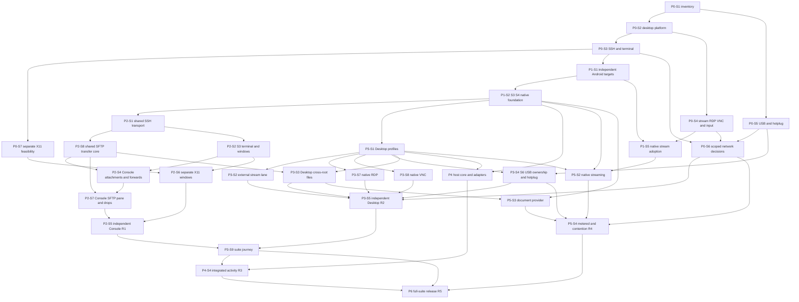

# Phase and stage roadmap

**Execution revision:** 2026-10-15, continuing the accepted Revision 02 decisions. **Scope:** independent Googlebook desktop/laptop Android packages under [Rule 0](../00-project/platform-rule-zero.md), Console X11/SFTP integration, Desktop native RDP/VNC and USB plug-and-play, optional host adapters and separately gated native high-performance streaming. [User decisions](../00-project/revision-02-final-review.md) now require independent app releases, early native-stream adoption and per-save overwrite consent on non-conditional file backends. No calendar start date or staffed team is assumed.

## Effort and release gates

The user-directed [established-library policy](library-reuse-policy.md) applies across all phases: adopt maintained engines, reuse their upstream validation and spend verification effort on Cloudy integration and demonstrated risks. Dependencies and release scope remain unchanged. The effort ranges below remain planning hypotheses until engine choices and remaining integration work justify a revised estimate.

| Phase | Stages | Active effort, person-days | Outcome / exit gate |
| --- | ---: | ---: | --- |
| [P0](phases/p0-qualification.md) | 7 | 15–28 | Scoped Android/input, SSH/X11, protocol/media, USB and network evidence; capability outcomes control dependent work |
| [P1](phases/p1-foundation.md) | 5 | 15–24 | Independent Android foundation, native workspace review, lifecycle/contracts and early native-stream adoption decision |
| [P2](phases/p2-console.md) | 8 | 33–59 | Reusable SSH/SFTP core and independent R1 Console: trusted terminal, separate X11 app windows, SFTP/edit/drop and app-scoped release checks |
| [P3](phases/p3-desktop.md) | 9 | 28–47 | Independent R2 Desktop: native RDP/VNC, external stream lane, files and enrolled USB; separate P3-S9 suite journey |
| [P4](phases/p4-host-integration.md) | 4 | 12–20 | R3 optional host core/adapters and attributed events; not a prerequisite for native streaming |
| [P5](phases/p5-integrated-desktop.md) | 3 | 16–27 | R4 native streaming, measured latency/stability, document provider and metered/contention policy |
| [P6](phases/p6-release.md) | 4 | 10–18 | R5 supported full-suite candidate: combined failure/migration/distribution and sustained use |
| **Total** | **40** | **129–223** | **25.8–44.6 person-weeks at five working days/week, before reserve/waiting** |

Add an illustrative **25% reserve**: **161.25–278.75 person-days**, or **32.25–55.75 person-weeks**. These are budgeting hypotheses, not delivery promises. Re-estimate after P0 feasibility and the early engine/build/distribution decisions. X11 native windows, USB provider control and actual sustained input/media behavior remain major uncertainties. Device access, upstream issues and distribution choices can increase elapsed time.

Revision 02 adds **4–6 active person-days** to Revision 01's 125–217 range for app-specific release reviews. The former P5-S1 decision moves to P1-S5 with its existing 2–3 day allowance. Splitting the existing suite journey into P3-S9 adds a stage without counting its effort twice. This replaces the previous total. Each app's ten-working-day candidate observation is distinct from active QA effort; periods may overlap only for exact builds and recorded workflows.

The implementation-readiness review further separates reusable transfer work into **P2-S8 (3–5 days)**. Its allowance moves **2–3 days from P2-S7** (now 3–6) and **1–2 days from P3-S3** (now 3–4); total effort remains **129–223 days**. P2-S1 retains its 3–5-day allowance while making its existing SSH transport/authentication work explicitly reusable. App-specific UI and integration regression checks remain in P2-S4/P2-S7/P3-S3. This is a redistribution of existing scope, not a claim that new evidence has reduced implementation cost.

## Dependency structure

This diagram summarizes the main paths. [backlog.json](backlog.json) contains every stage prerequisite and required capability outcome.

Console and Desktop can release independently after their own [app-scoped release gates](release-gates.md). P3-S9 validates the combined journey afterward. Desktop uses P2-S1/P2-S8 as reusable source prerequisites and does not wait for Console PTY/renderer, tabs/panes, attachment UI, SFTP pane, X11 or release. The `CAP-SSH` transport decision is separate from `CAP-TERMINAL`: a renderer-only IME/accessibility blocker can leave Console blocked while Desktop files proceed through a qualified SSH/SFTP route. Shared code never requires an installed Console package or shared credential store.

P1-S5 resolves native-stream adoption from P0 evidence. P5-S2 can proceed once its own engine, native foundation and profile prerequisites pass, independently of P4. The document provider depends on files/lifecycle, independently of streaming adoption. Full-suite P6 still includes optional-in-runtime host features in the supported suite scope; this does not hold a standalone R1/R2 release.

Phase numbers and release labels organize scope; they are not a requirement to finish every earlier phase before starting another branch. P5-S1 is retired in favor of P1-S5; other stage IDs remain stable. Parallel work depends on staffing, and effort remains additive. Standard SSH/RDP/VNC retain ordinary-server operation without the custom host agent.

## First ten working days: investigation order

This is an initial order, not a promise that P0 will finish within ten days.

| Window | Work | Reviewable evidence |
| --- | --- | --- |
| Days 1–2 | P0-S1 inventory/ADB; P0-S2 desktop API/lifecycle probes | Actual build/topology, operation lifetimes and scoped blockers |
| Days 3–4 | P0-S3 terminal/input; native-stream and RDP/VNC candidate investigation | Trust/IME evidence, engine/build and distribution questions |
| Days 5–6 | P0-S7 X11 broker; P0-S4 protocol/media probes | Separate apps/dialogs and actual native surface/input paths |
| Days 7–8 | Decoder/input baseline; P0-S5 actual probe/hotplug | Measurement limits, permission/control and reenumeration identities |
| Days 9–10 | Continue bounded experiments; scoped P0-S6 runs; prepare P1-S5 when prerequisites pass | Per-capability decisions, raw evidence and revised estimates |

Complete every P0 investigation record before declaring the entire phase done. An unfinished or blocked X11 investigation does not hold unrelated Desktop work; it still prevents a full Console support claim. Useful early SSH or launcher builds remain partial milestones with clear unmet requirements.

## Stage completion protocol

Each stage records prerequisites, owner, effort, tasks, deliverables, exit criteria, sources, cases and evidence directory. Status is `planned → ready → in-progress → review → done`; blocked names the concrete reason. [Capability outcomes](feasibility-gates.md) separately use `pending`, `supported`, `experiment` and `blocked`.

An investigation may finish with a blocked capability decision. Dependent product work requires a supported outcome and completed prerequisites. Bounded experiments record a hypothesis, owner, effort cap, stop condition and expected evidence. At the current checkpoint, CAP-FOUNDATION supports scoped native construction, CAP-PLATFORM/CAP-SSH/CAP-TERMINAL are experiments and five feature outcomes remain pending. P0-S3 investigation is complete and P1-S1 is ready. [ADR0012](../adr/0012-foundation-construction-and-platform-acceptance.md) explicitly retains the broader platform gate at R1/R2/R4 acceptance; no app is implemented by admission. See the [execution state](execution-state.md#stage-and-product-status) for progress beyond the initial plan.

A fallback that changes requested behavior requires an explicit scope decision, qualification and re-estimation. A single full X desktop cannot pass separate X11 windows; an external RDP/VNC viewer cannot pass native-client gates; a lab-side USB provider does not certify local Googlebook plug-and-play. Documentation checks never establish hardware results.

## Scope controls

Phone/tablet optimization, phone Continue On, team vault/cloud sync, universal macOS notification capture, private local-VM control, automatic agent approvals and a strict two-installed-packages promise remain outside the plan. Required X11, SFTP/drop, RDP/VNC and enrolled USB workflows remain included. Native high-performance streaming remains a full-scope target; an external-only change requires an explicit scope decision. The user-selected overwrite policy prompts for every remote replacement on a backend without conditional protection and preserves pending local work on cancel or uncertainty.
