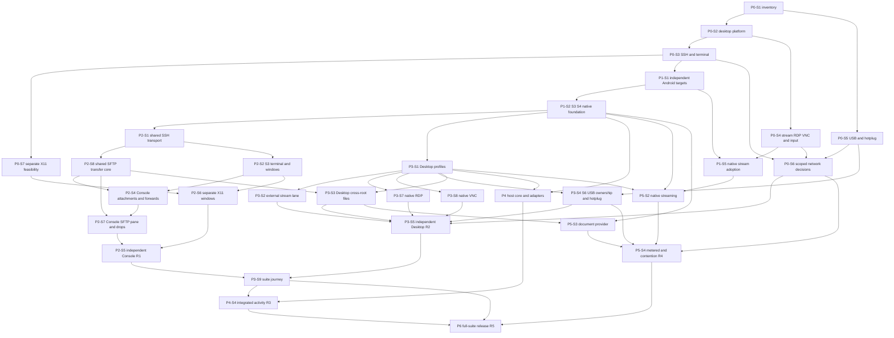

# Phase and stage roadmap

**Execution revision:** 2026-10-15, continuing the accepted Revision 02 decisions. **Scope:** independent Googlebook desktop/laptop Android packages under [Rule 0](../00-project/platform-rule-zero.md), Console X11/SFTP integration, Desktop native RDP/VNC and USB plug-and-play, optional host adapters and separately gated native high-performance streaming. [User decisions](../00-project/revision-02-final-review.md) now require independent app releases, early native-stream adoption and per-save overwrite consent on non-conditional file backends. No calendar start date or staffed team is assumed.

## Execution outcomes and release gates

The [established-library policy](library-reuse-policy.md) remains mandatory: reuse maintained engines and their upstream evidence, and test changed Cloudy integration boundaries and concrete risks.

Delivery-time estimates are withdrawn by the user. Agent count and historical person-day budgets do not establish elapsed delivery. Track implementation through accepted workflows and the gates below. The original effort fields retained in `backlog.json` are historical planning provenance, not an active schedule; this revision does not change stage dependencies or reduce scope.

| Phase | Stages | Outcome / exit gate |
| --- | ---: | --- |
| [P0](phases/p0-qualification.md) | 7 | Scoped Android/input, SSH/X11, protocol/media, USB and network evidence; capability outcomes control dependent work |
| [P1](phases/p1-foundation.md) | 5 | Independent Android foundation, native workspace review, lifecycle/contracts and early native-stream adoption decision |
| [P2](phases/p2-console.md) | 8 | Independent Console: trusted terminal, separate X11 app windows, SFTP/edit/drop and app-scoped release checks |
| [P3](phases/p3-desktop.md) | 9 | Independent Desktop: native RDP/VNC, files and enrolled USB; separate suite journey |
| [P4](phases/p4-host-integration.md) | 4 | Optional host core/adapters and attributed events; not a prerequisite for native streaming |
| [P5](phases/p5-integrated-desktop.md) | 3 | Native streaming, measured latency/stability, document provider and metered/contention policy |
| [P6](phases/p6-release.md) | 4 | Supported suite candidate: failure/migration/distribution checks and sustained use |

Formal client assembly proceeds incrementally using the approved design, real qualified operations and explicit unavailable states for remaining features. Direct Codex GPT-6.1 Sol and authorized OMP coworkers work together under parent integration/visual review. The current client priority is Desktop VNC connection, presentation, desktop input, fullscreen/overlay and reliable retirement. Host work remains parallel. No partial assembly closes a complete stage or release gate.

Required sustained-use observation periods remain acceptance criteria, not delivery forecasts. The historical decisions moving stream adoption to P1-S5 and splitting shared transfers into P2-S8 preserve their existing dependencies without creating an elapsed schedule.

## Dependency structure

The user explicitly requested [parallel client and host development](parallel-execution-contract.md). Bounded host construction/research can proceed independently under the [HOST-EXP01 entry](../03-platform/host-core-entry.md); integrated P4 prerequisites below remain unchanged. This is host-side Windows/Linux/macOS software, not a new client-platform roadmap. The existing40-stage denominator and effort hypothesis are retained.

This diagram summarizes the main paths. [backlog.json](backlog.json) contains every stage prerequisite and required capability outcome.

Console and Desktop can release independently after their own [app-scoped release gates](release-gates.md). P3-S9 validates the combined journey afterward. Desktop uses P2-S1/P2-S8 as reusable source prerequisites and does not wait for Console PTY/renderer, tabs/panes, attachment UI, SFTP pane, X11 or release. The `CAP-SSH` transport decision is separate from `CAP-TERMINAL`: a renderer-only IME/accessibility blocker can leave Console blocked while Desktop files proceed through a qualified SSH/SFTP route. Shared code never requires an installed Console package or shared credential store.

P1-S5 resolves native-stream adoption from P0 evidence. P5-S2 can proceed once its own engine, native foundation and profile prerequisites pass, independently of P4. The document provider depends on files/lifecycle, independently of streaming adoption. Full-suite P6 still includes optional-in-runtime host features in the supported suite scope; this does not hold a standalone R1/R2 release.

Phase numbers and release labels organize scope; they are not a requirement to finish every earlier phase before starting another branch. P5-S1 is retired in favor of P1-S5; other stage IDs remain stable. Parallel work depends on staffing, and effort remains additive. Standard SSH/RDP/VNC retain ordinary-server operation without the custom host agent.

## Remaining investigation order

Use the current [execution state](execution-state.md), not a dated day-by-day plan, to select the next operation. Carry forward accepted evidence. Remaining investigations include X11 separate-window feasibility, native engine/input/performance, USB with an identified target, scoped network measurements and early stream adoption. Missing hardware or a blocked capability does not hold unrelated ready product work; it still prevents the corresponding full support claim.

Every completed stage links actual evidence. Documentation and compiler checks do not qualify a device.

## Stage completion protocol

Each stage records prerequisites, owner, tasks, deliverables, exit criteria, sources, cases and evidence directory. Status is `planned → ready → in-progress → review → done`; blocked names the concrete reason. [Capability outcomes](feasibility-gates.md) separately use `pending`, `supported`, `experiment` and `blocked`.

An investigation may finish with a blocked capability decision. Dependent product work requires a supported outcome and completed prerequisites. Bounded experiments record a hypothesis, owner, bounded scope, stop condition and expected evidence. At the current checkpoint, CAP-FOUNDATION supports scoped native construction, CAP-PLATFORM/CAP-SSH/CAP-TERMINAL are experiments and five feature outcomes remain pending. P0-S3 investigation and P1-S1 native foundation are complete; P1-S2/P1-S3 remain in progress. [ADR0012](../adr/0012-foundation-construction-and-platform-acceptance.md) explicitly retains the broader platform gate at R1/R2/R4 acceptance; no app is implemented by admission. See the [execution state](execution-state.md#stage-and-product-boundaries) for progress beyond the initial plan.

A fallback that changes requested behavior requires an explicit scope decision, qualification and updated acceptance gates. A single full X desktop cannot pass separate X11 windows; an external RDP/VNC viewer cannot pass native-client gates; a lab-side USB provider does not certify local Googlebook plug-and-play. Documentation checks never establish hardware results.

## Scope controls

Phone/tablet optimization, phone Continue On, team vault/cloud sync, universal macOS notification capture, private local-VM control, automatic agent approvals and a strict two-installed-packages promise remain outside the plan. Required X11, SFTP/drop, RDP/VNC and enrolled USB workflows remain included. Native high-performance streaming remains a full-scope target; an external-only change requires an explicit scope decision. The user-selected overwrite policy prompts for every remote replacement on a backend without conditional protection and preserves pending local work on cancel or uncertainty.
