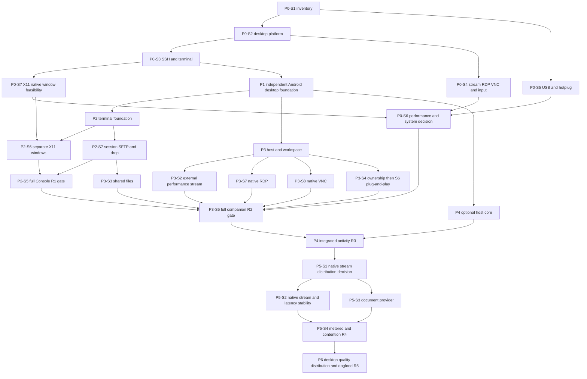

# Phase and stage roadmap

**Revision 01:** 2026-10-14. **Scope:** independent Googlebook desktop/laptop Android packages under [Rule 0](../00-project/platform-rule-zero.md), Console X11/SFTP integration, Desktop native RDP/VNC and USB plug-and-play, optional host adapters and separately gated native high-performance streaming. No calendar start date or staffed team is assumed.

## Effort and release gates

| Phase | Stages | Active effort, person-days | Outcome / exit gate |
| --- | ---: | ---: | --- |
| [P0](phases/p0-qualification.md) | 7 | 15–28 | Desktop APIs/input, SSH/X11 broker, stream/RDP/VNC, USB hotplug and network evidence; capability blockers explicit |
| [P1](phases/p1-foundation.md) | 4 | 13–21 | Independent Android packages, shared desktop design/lifecycle/contracts, early native-engine license/build gates |
| [P2](phases/p2-console.md) | 7 | 30–54 | Full R1 Console: trusted terminal, separate X11 app windows, session-linked SFTP/edit/drop and full day without Desktop/host agent |
| [P3](phases/p3-desktop.md) | 8 | 27–46 | Full R2 companion: native RDP/VNC, external performance-stream lane, files, enrolled USB plug-and-play and build/program/inspect journey |
| [P4](phases/p4-host-integration.md) | 4 | 12–20 | R3 optional host core/adapters; attributed events and offline/gap/permission behavior |
| [P5](phases/p5-integrated-desktop.md) | 4 | 18–30 | R4 native high-performance stream, measured latency/stability, document provider, metered/accounting and contention policy |
| [P6](phases/p6-release.md) | 4 | 10–18 | R5 supported Googlebook release: failure/migration, signed Android distribution, desktop quality evidence and ten-day dogfood |
| **Total** | **38** | **125–217** | **25–43.4 person-weeks at five working days/week, before reserve/waiting** |

Add an illustrative **25% reserve**: **156.25–271.25 person-days**, or **31.25–54.25 person-weeks**. These are planning ranges, not delivery promises. Re-estimate after P0 feasibility and P1 engine/build/license work. X11 native window integration has the largest new implementation uncertainty; physical access, upstream issues and distribution decisions can increase elapsed time.

Revision 01 adds 41–74 active person-days to the initial 84–143 range through six new stages and expanded platform/protocol/performance work. It replaces that baseline; do not add both full totals. The original intake estimate had different scope. Ten working days of candidate use is an observation minimum, separate from active QA effort.

## Dependency structure

The canonical DAG is [backlog.json](backlog.json). Stage numbers are stable identifiers; added S6/S7/S8 work can precede an existing S5 release gate. Parallel branches are possible if staffed; effort remains additive. A Desktop-only device issue does not prevent terminal development. The full Console gate waits for required X11/SFTP work; full Desktop waits for native RDP/VNC and qualified plug-and-play.

P1-S4 reviews X server/RDP/VNC licensing and native dependencies before integration. P5-S1 separately resolves high-performance streaming embedding. Standard SSH/RDP/VNC do not acquire a custom host-agent prerequisite through USB/event architecture.

## First ten working days: investigation order

This is an initial order, not a claim the expanded P0 can finish in ten days.

| Window | Work | Reviewable evidence |
| --- | --- | --- |
| Days 1–2 | P0-S1 inventory/ADB; P0-S2 desktop package/API/lifecycle probes | Actual Googlebook build/topology, Rule 0 applicability and blockers |
| Days 3–4 | P0-S3 SSH/renderer/IME and X11 engine hooks | Trust/input evidence and engine comparison |
| Days 5–6 | Begin P0-S7 X server/native window broker; P0-S4 desktop engine probes | Two-app/dialog feasibility and RDP/VNC build/security paths |
| Days 7–8 | Continue input/decoder/stream baseline; begin P0-S5 probe/hotplug | Physical input, codec observations, permission/control and identity map |
| Days 9–10 | Continue highest-risk spikes; start P0-S6 measurements where ready | Raw baseline data, missing prerequisites and revised estimates |

Complete all P0 exit evidence before declaring the phase done. An earlier usable SSH build or external stream launcher is a partial milestone without a date promise or removal of requested scope.

## Stage completion protocol

Each stage records prerequisites, owner role, effort, tasks, deliverables, exit criteria, official/upstream sources, acceptance cases and evidence directory. Status is `planned → ready → in-progress → review → done`; blocked includes the concrete dependency. Update backlog and phase prose together.

Done requires passing exit evidence. A fallback that changes requested behavior requires a documented scope decision, qualification and re-estimation. A single full X desktop cannot pass separate X11 windows; an external RDP/VNC viewer cannot pass native integrated client gates; a lab-side USB provider does not certify Googlebook local plug-and-play. Document checks do not establish hardware results.

## Scope controls

Phone/tablet optimization, phone Continue On, team vault/cloud sync, universal macOS notification capture, private local-VM control, automatic agent approvals and a strict two-installed-packages promise are outside the plan. Required X11, SFTP/drop, RDP/VNC and enrolled USB workflows are included. Native high-performance streaming remains a full-scope target with a prior distribution/maintenance gate; any external-only revision states unmet integration and updates scope/effort explicitly.
