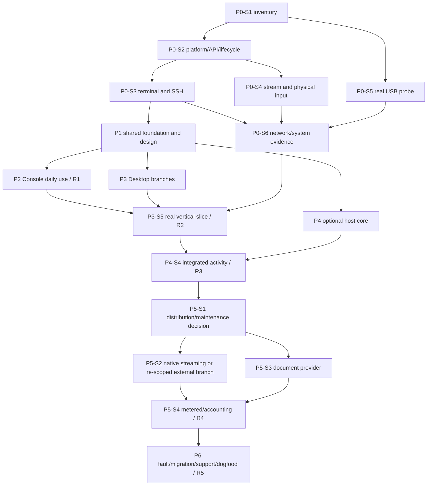

# Phase and stage roadmap

**Baseline:** 2026-10-14. **Scope:** independent Console and Desktop products, native shared design system, optional host core/adapters, files/devices, and separately gated integrated streaming. There is no calendar start date or staffed team assumption.

## Effort and release gates

| Phase | Active effort, person-days | Outcome | Exit gate |
| --- | ---: | --- | --- |
| [P0](phases/p0-qualification.md) | 8–16 | Platform/input/renderer/stream/probe/network evidence | Critical risks qualified or a tested fallback accepted |
| [P1](phases/p1-foundation.md) | 9–15 | Independent APKs, shared native design/contracts/lifecycle/CI | Independent installs, safe IPC, real input/focus evidence |
| [P2](phases/p2-console.md) | 15–25 | R1 daily-use Console | Full coding day without Desktop/host agent |
| [P3](phases/p3-desktop.md) | 13–21 | R2 Desktop companion | Real edit/build/program/inspect vertical slice |
| [P4](phases/p4-host-integration.md) | 12–20 | R3 optional agent/events/adapters | Attributed deduplicated events, offline/gap/permission behavior |
| [P5](phases/p5-integrated-desktop.md) | 17–28 | R4 native stream branch + document provider/metered policy | Actual CAD, conflict-safe editing, measured accounting |
| [P6](phases/p6-release.md) | 10–18 | R5 supported release | Fault/migration gates and ten working days of dogfooding |
| **Total** | **84–143** | **16.8–28.6 person-weeks at five days/week** | Before contingency and external waiting |

Add an illustrative **25% reserve**: **105–178.75 person-days**, or approximately **21–36 person-weeks**. This is an engineering planning range, not a delivery commitment. Re-estimate after P0/P1. Device availability, upstream changes, distribution work, and personal availability can increase elapsed time. Ten-day dogfooding is an observation minimum; its active QA effort is smaller than that window.

The original 18–31 person-week estimate was a coarse scope estimate. These stage sums overlap that range but make work/dependencies explicit; reserve and waiting are now visible. Do not add the original estimate to this one.

## Dependency structure

The exact DAG lives in [backlog.json](backlog.json). Some branches may overlap when staffed; the estimates are additive active effort. Console does not wait for a Desktop-only probe problem once its own platform/renderer gates pass. The first complete Desktop release does wait for a qualified hardware topology.

## First ten working days: suggested order

This is an order of investigation, not a promise all experiments finish within ten days.

| Window | Work | Reviewable evidence |
| --- | --- | --- |
| Days 1–2 | P0-S1 inventory/ADB; begin P0-S2 API and lifecycle map | Exact build/topology and unresolved requirements |
| Days 3–4 | P0-S3 SSH/renderer/IME spike | Real input/host-trust results and engine choice |
| Days 5–6 | P0-S4 native stream/input/decoder spike | Actual trackpad/CAD/capture evidence and handoff mechanism |
| Days 7–8 | P0-S5 probe programming/reset/ownership | Flash/verify trace or qualified fallback experiment |
| Days 9–10 | P0-S6 network samples; P0 decision; start P1 if ready | Measured baseline, capability exclusions, revised estimates |

For a one-developer implementation, an early useful Console plus launcher-oriented Desktop remains plausible around the original 6–12 elapsed-week range if P0 passes quickly; the full integrated scope is much larger. Treat this as a scenario, not a date guarantee.

## Stage completion protocol

Each stage records status, prerequisite IDs, owner role, effort range, tasks, outputs, source IDs, acceptance cases, and evidence directory. Status transitions are `planned → ready → in-progress → review → done`, with `blocked` accompanied by the concrete dependency. Update the machine-readable backlog and phase prose together.

A stage reaches done only when its exit criteria pass or a deliberately accepted and qualified fallback replaces them. Link runs, versions, defect IDs, and the resulting support-matrix rows. A checkbox or passing source-link check does not establish hardware compatibility.

## Scope controls

Keep X11 hosting, team vault/cloud sync, universal macOS notifications, local VM attachment, automatic agent approvals, and a strict two-installed-packages promise outside v1. Native streaming can remain external-only after P5-S1; if so, replace and re-estimate P5-S2 explicitly. Do not silently keep its feature claims while removing its implementation work.
