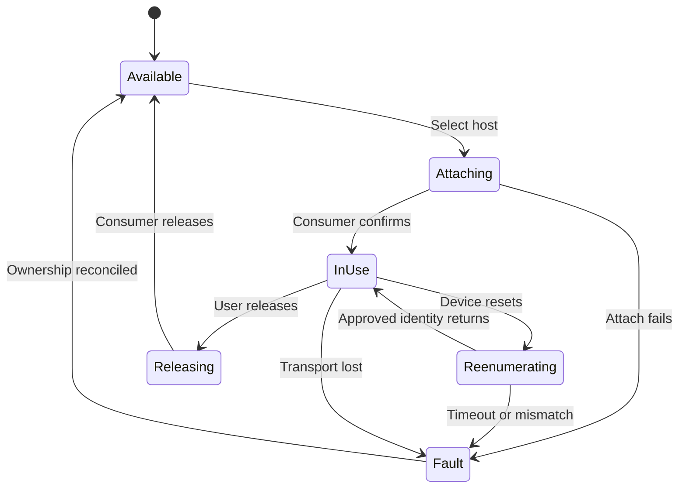

# GoogleBook Self-Cloud Workspace

## Two-application architecture, implementation plan, and network budget

**Prepared:** 14 October 2026  
**Status:** Research-backed design proposal; hardware qualification remains required.  
**Primary client:** HP GoogleBook 14.  
**Hosts:** Mac Studio, MS-02Ultra with RTX PRO 4000 Blackwell SFF, ASUS Zenbook Duo, HP ZBook Ultra G1a.  
**Host operating systems:** Windows, macOS, Linux with Wayland.

This document separates documented capabilities from proposed engineering choices and estimates. A documented Android feature does not establish that every GoogleBook peripheral, OS build, or application behaves correctly. Bandwidth figures below are planning assumptions, not benchmarks of the user's equipment. All cited sources were consulted during this research session or its immediately preceding research on the same project; links are collected in Section 18.

## 1. Executive decision

Build **two independently useful GoogleBook applications**, supported by shared libraries and optional host agents:

1. **Remote Workspace:** remote desktop, host/cloud file access, transfers and sharing, USB assignment, host notifications, device status, and saved workspaces.
2. **GoogleBook Terminal:** a hardware-keyboard-first SSH terminal with tabs, panes, durable remote sessions, port forwarding, and compatibility with agentic command-line applications.

The split is worthwhile because terminal work should remain usable when video streaming fails, consume little network traffic, and require neither USB nor screen-capture permissions. It also allows both apps to occupy separate desktop windows. Shared source libraries do not require a shared process or shared credential store.

Use established transport and rendering components before building new ones:

| Concern | Initial decision | Qualification condition |
| --- | --- | --- |
| Network | Existing Tailscale app on GoogleBook and hosts | Bidirectional connectivity and direct-path performance |
| Desktop | Sunshine hosts and Moonlight Android baseline | Each OS, compositor, GPU, decoder, and input path tested |
| Terminal | Native SSH transport; xterm.js renderer prototype | Physical keyboard, IME, TUI and sustained-output tests |
| USB | VirtualHere Android server and workstation consumers | Actual debug cables and re-enumeration tests |
| Files | SFTP plus Google Drive access | Correct remote-write and cache behavior |
| UI | Carbon React in bundled WebView with native Android integration | Desktop-quality focus, accessibility, and lifecycle |
| Host integration | Go core plus OS-specific user-session adapters | No assumption that a system service can capture a desktop |
| Agent execution | Execute on the selected host; terminal is the interface | Provider-specific authentication and runtime tests |

**Release gates:** the primary development probe, physical trackpad relative mode, and chosen Wayland compositor must pass before claiming the system replaces a conventional development laptop. Complete arbitrary macOS notification forwarding is not a committed capability.

## 2. Platform findings and implications

### 2.1 GoogleBook is a desktop product on the Android stack

Google's GoogleBook documentation describes Android foundations, desktop windowing, physical keyboards, trackpads, and an isolated Linux development environment. HP identifies the GoogleBook 14 platform as Snapdragon X Elite. Target Android ARM64 applications optimized for GoogleBook, not a phone interface scaled to a laptop. [S01, S02]

Google's desktop guidance includes multi-window use, resize behavior, contextual menus, keyboard navigation, and pointer interactions. Use that guidance as an acceptance standard. Do not replace the system launcher or input method to achieve desktop usability; Google currently documents restrictions on custom GoogleBook IMEs and launchers through Play. [S03, S04]

The Linux environment is optional for this architecture. A public mechanism for a third-party terminal app to attach to the built-in Linux VM must be established experimentally or through documentation. Do not presume Crostini integration, direct host filesystem access, privileged USB access, or a stable VM-control API.

### 2.2 Physical inventory to collect

| Item | Record before implementation |
| --- | --- |
| GoogleBook | Exact SKU, OS/build/API level, RAM, display modes, WebView version, hardware decoders |
| Hosts | Installed OS/version, CPU architecture, GPU/driver, active user/session |
| Linux | Distribution, kernel, GNOME/KDE/wlroots compositor and version |
| Displays | Physical/virtual display arrangement, resolution, scaling, headless behavior |
| Networking | Host upload, client download/upload, LAN topology, NAT restrictions |
| USB | Exact device and firmware, VID/PID, serial, bootloader identities, target tool/version |
| Agent tools | CLI names and versions, authentication method, working environments |

The host hardware names do not establish their installed OSes. Use capability discovery rather than hard-coded model-based behavior.

## 3. Product boundaries

### 3.1 Remote Workspace responsibilities

- Connect to and switch among hosts.
- Open the host desktop, choose monitor/resolution, and select input mode.
- Browse local GoogleBook files, host directories, and Drive locations.
- Stage, transfer, resume, and track files; expose suitable remote files through Android's file picker.
- Assign an attached USB device to exactly one consuming host.
- Display host notifications with host/app attribution and available actions.
- Save workspace profiles tying a host, project, desktop settings, and optional peripherals together.
- Open a selected project in the Terminal app.
- Show network path, measured usage, backend errors, and permissions.

### 3.2 GoogleBook Terminal responsibilities

- Work independently with an ordinary SSH server; the custom host agent is optional.
- Manage SSH profiles, host-key trust, credentials, jump hosts, and local port forwarding.
- Provide tabs, split panes, multiple windows, search, selections, readable fonts, and reliable clipboard handling.
- Attach to durable remote sessions and distinguish detach, disconnect, terminate, and stop-agent actions.
- Run arbitrary terminal software, including agentic coding CLIs, rather than depending on one model vendor.
- Transfer prompt attachments and images to the active host through a small built-in SFTP utility.
- Present optional agent status, completion alerts, and artifact links when structured adapters exist.
- Open a remote directory or artifact in Workspace when installed.

The small attachment uploader is intentionally duplicated at the user-facing feature level: Terminal must not depend on installing Workspace merely to give an agent a screenshot. Its transfer implementation is shared code.

### 3.3 Explicit non-goals for v1

- A new remote-video codec, USB virtualization driver, or SSH protocol.
- Transparent migration of a live process between different hosts.
- Universal POSIX mounting of cloud files into every Android application.
- Full-fidelity forwarding of every host notification action.
- Automatic approval of agent tool calls.
- Unattended pre-login desktop access on every OS configuration.
- Replacement of all remote IDE functionality.
- A public file-sharing cloud or mandatory central relay.

### 3.4 Installation reality

Two apps means two project-owned user applications. During early releases, Tailscale, Moonlight, and VirtualHere may remain separate installed dependencies. Achieving exactly two total installed packages would require deeper integrations, permissions analysis, and licensing work; it is not the MVP promise.

## 4. Architecture and shared contracts

### 4.1 Components

| Component | Location | Responsibilities |
| --- | --- | --- |
| Workspace APK | GoogleBook | Carbon shell, file browser, notification inbox, desktop/USB orchestration |
| Terminal APK | GoogleBook | Terminal UI, SSH/SFTP, forwarding, session restoration |
| Shared Kotlin modules | Compiled into both apps | Profile schema, SSH primitives, transfer logic, diagnostics, theme tokens |
| Host agent | Each workstation, optional for SSH | Capability manifest, events, managed jobs, desktop/USB adapters |
| User-session helper | Host logged-in session | Desktop permissions, notifications, session-aware actions |
| Privileged helper | Host, only when needed | Narrow installation/device operations |
| Existing backends | Appropriate machines | Tailscale, Sunshine, SSH server, USB consumer |
| Optional coordinator | Always-on owned host | Event retention and wake orchestration; not on media path |

Keep media, USB, and bulk file data on their direct backend paths. Do not tunnel them through a UI WebView or central host-agent event connection.

### 4.2 Shared profiles without a fragile shared daemon

Use independently stored profiles in each app. On first pairing, offer explicit import of non-secret host information through a signature-protected IPC service. Credentials remain in the owning app unless the user explicitly enrolls another key.

Prefer separate per-app SSH keys for revocation. Android Keystore may protect wrapping keys for encrypted SSH private-key storage; direct Keystore-backed SSH signing depends on algorithm and library compatibility and must be qualified. Do not assume all SSH key types are exportable hardware-backed Keystore keys.

Cross-app requests should include a version, host ID, environment ID, workspace ID, and resource ID. Use explicit components and signature-level access control for privileged IPC. Links from browsers may select a resource but must never execute arbitrary commands.

Example intent semantics:

```json
{
  "version": 1,
  "action": "open-terminal",
  "hostId": "workstation-ms02",
  "environmentId": "linux-dev",
  "workspaceId": "fpga-project",
  "directoryId": "registered-project-root"
}
```

This is a proposed contract, not an existing API. Resolve paths on the receiver; handle Windows, POSIX and WSL paths explicitly. Avoid shell-string interpolation. Prefer structured process arguments or a dedicated host RPC for managed launches.

### 4.3 Host-agent contract

Publish a versioned capability manifest and a resumable event stream. Suggested fields:

- Host installation identity, OS, user-session ID, boot ID, agent version.
- Supported API versions and backend versions.
- SSH endpoint and available environments.
- Desktop status, capture backend, permissions, displays, codec capabilities.
- USB consumer availability and owned devices.
- Notification capability flags: text, source icon, dismissal, action invocation.
- Approved file roots and managed jobs.

Use HTTPS with explicit pairing and verified server identity over Tailscale. A device being inside the tailnet is not sufficient application authorization. Commands need request IDs, expiration, and idempotency handling. Never automatically replay a failed flash or arbitrary shell command after reconnect.

Events should carry sequence numbers and timestamps; support replay from a cursor with bounded retention. Mark gaps rather than suggesting complete history when a queue has expired.

## 5. Remote Workspace detailed design

### 5.1 Desktop transport selection

Sunshine/Moonlight is the initial interactive performance candidate. Sunshine documents multiple Linux capture paths, including KMS, portals, KWin and wlroots, plus Windows and macOS capture. Its current setup documentation still marks macOS experimental. Pin tested releases rather than assuming the latest documentation exactly matches an installed build. [S05, S06]

| Backend | Use | Limitation to preserve in UI |
| --- | --- | --- |
| Sunshine/Moonlight | Primary CAD/interactive desktop | Tested combinations only |
| Windows RDP | Optional productivity environment | May change session behavior; not interchangeable with console streaming |
| RustDesk | Optional support/recovery | Documented Wayland and login-screen limitations |
| Parsec | Comparison on Windows/macOS | No Linux hosting; Android documented as experimental |

RustDesk and Parsec are alternatives to test, not dependencies required for release. [S07, S08]

Initially launch Moonlight with a configured host/profile using supported mechanisms. Do not promise an integration API that has not been verified. If a seamless in-app stream becomes necessary, evaluate a maintained Moonlight-derived native activity. Moonlight Android is GPL-3.0; decide distribution and source-availability requirements before embedding it. VirtualHere requires its own licensing review. [S09, S10]

### 5.2 Native video and input

Use native video decode/rendering; UI controls can be Carbon. Do not draw decoded frames through React or move them through a JSON bridge.

Implement these profiles:

- **Desktop:** absolute pointing, normal selection, context menus, scroll.
- **CAD:** relative capture with configurable orbit/pan bindings and middle-button emulation.
- **Presentation:** high readability, muted remote input unless enabled.
- **Metered:** lower bitrate/frame rate and no background preview streams.

Android supports pointer capture, but physical trackpad behavior needs on-device testing. Touchscreen trackpad emulation does not prove physical trackpad support. [S11]

Input requirements include capture release on focus loss, clearing held modifiers after disconnect, configurable natural scrolling, horizontal scroll, middle-click, right-click, modifier-plus-drag, and host-specific Command/Ctrl mappings. Offer a visible release shortcut. Never steal system-reserved shortcuts or rely on an accessibility service as a global keylogger.

Test Blender or the actual CAD application: endless orbit, pan, zoom, axis constraints, text fields, drag across the display edge, and switching back to GoogleBook windows. Gesture-to-command mapping is acceptable when documented; universal raw multitouch forwarding is not promised.

### 5.3 Host lifecycle matrix

Qualify unlocked session, lock, logout, reboot, sleep, resume, monitor-off, monitor-unplug, and headless operation separately. On Wayland record the actual compositor and capture/input methods. Prefer least-privileged capture that meets requirements; any KMS privilege requirement must be explicit.

Do not promise access before encrypted boot volumes are unlocked. Wake-on-LAN, if supported, requires a suitable powered device on the host LAN or another supported wake mechanism; Tailscale cannot wake a powered-off endpoint by itself.

### 5.4 Files and sharing

Expose distinct roots: Google Drive, host workspace, local GoogleBook, and optional shared lab storage. A unified browser must not imply identical filesystem semantics.

Google Drive for desktop supports Windows/macOS, not Linux. Evaluate rclone for Linux; its VFS cache introduces delayed writeback. On GoogleBook use the existing Drive provider or a carefully scoped Drive API integration if needed. [S12, S13]

Use SFTP first for direct host access. SMB is optional where already useful; do not enable public internet SMB. Linux/host mounts can be configured separately but are not required for the app.

Build a DocumentsProvider for selected remote roots so compatible Android applications can use the system file picker. This provides URI/document access, not a universal filesystem mount. [S14]

Transfer requirements:

1. Copy to a temporary destination, verify length and optionally hash, then publish using backend-appropriate semantics.
2. Record transfer job, source identity/version, destination, bytes complete, and error state.
3. Resume only when the source version still matches.
4. Stage remote edits locally, then verify the remote version before upload.
5. Preserve a conflict copy instead of silently overwriting a competing edit.
6. Distinguish queued, cached, uploading, committed remotely, and synced to Drive.
7. Bound cache size and expose offline pinning and eviction controls.
8. Treat symlinks, case sensitivity, Windows reserved names, permissions, and Google-native documents explicitly.

Active repositories, build output trees, toolchain caches, databases, and VM images should remain local to the execution host. Git handles source history; Drive holds documents and selected artifacts. Do not implement destructive bidirectional sync in v1.

Sharing defaults to a selected owned host. External Drive links require an explicit choice of recipients/access; tailnet file access is not automatically public sharing. Cross-host copy can be host-to-host rather than passing through GoogleBook.

### 5.5 USB ownership and forwarding

The GoogleBook is the USB **provider**, even though it is the desktop client. VirtualHere documents an Android server with Windows/macOS/Linux consumers. Test it before writing any custom USB implementation. [S10, S15]

Use a powered hub as needed; verify charging, hub compatibility, and Ethernet coexistence. Configure the GoogleBook tailnet address explicitly. LAN autodiscovery is not a reliable cross-tailnet mechanism.

Proposed state machine:



USB has exclusive ownership. Reconciliation must query the actual backend; a UI lease expiring does not prove that a consumer has released the device. During firmware programming, do not reassign automatically. If the backend cannot report operation state, expose a user-controlled protected-operation mode.

Test UART, ESP32 auto-reset, CMSIS-DAP/ST-Link/J-Link, actual FPGA cable, composite interfaces, and DFU transitions. Android USB access and reset/configuration control differ from full Linux access; a successful serial connection does not certify a JTAG cable. [S16]

For peripherals that fail, support a small Linux USB-provider appliance near the hardware. For appropriate FPGA workflows, a vendor hardware server near the board can avoid raw USB transport; AMD documents remote Vivado hardware-server operation. This needs supported CPU/OS hardware and must not be assumed runnable in GoogleBook's VM. [S17]

### 5.6 Notifications

| Origin | Initial implementation | Expected fidelity |
| --- | --- | --- |
| Workspace/agent jobs | Own structured events | Reliable title, body, host, job link |
| Windows | UserNotificationListener user-session adapter | Text/app information/icons; actions separately qualified |
| Linux | KDE Connect evaluation or desktop-specific adapter | Depends on notification service and desktop |
| macOS | Own events and supported app integrations | Arbitrary system-wide capture not guaranteed |

Windows documents notification access with user permission. Freedesktop specifies notification transport but not a universal observer history API. KDE Connect documents desktop notification sending. Apple's public UserNotifications center is scoped to the app. [S18–S21]

Store host/app/source IDs, creation/update times, expiry, icon hash, capabilities and forwarding origin. Cache icons by content hash, bound image dimensions, and sanitize rich text. Source icons belong in the app inbox; Android's system shade still attributes posting to the workspace app. [S22]

Suppress loops. Do not merge messages solely by equal text. After reconnect, show expired events in history without generating a storm of fresh alerts. Background delivery requires lifecycle qualification, not an assumption that a permanent WebSocket always survives.

## 6. GoogleBook Terminal detailed design

### 6.1 Desktop-first interaction specification

Terminal opens into useful sessions and a compact host/project selector. No phone-style row of giant extra keys is shown by default. Offer an optional command palette and shortcut reference.

| Input/action | Required behavior |
| --- | --- |
| Ctrl+C | Send interrupt; never silently replace with copy |
| Ctrl+Shift+C / V | Copy / paste |
| Ctrl+Insert / Shift+Insert | Optional alternate copy / paste |
| Drag selection | Exact text selection; no accidental command execution |
| Double/triple click | Word/line selection with configurable word rules |
| Shift+drag | Local selection override when remote mouse reporting is active |
| Right click | Context menu by default; paste optional |
| Trackpad | Smooth scroll, correct alternate-screen behavior |
| Ctrl+wheel | Configurable zoom; avoid unintended host input |
| Resize | Debounced PTY resize without corrupting the display |
| IME | Chinese/English composition, candidate selection and committed text |
| Shift+Enter | Negotiated extended key or explicit per-tool mapping |
| Ctrl+J | Preserve literal terminal meaning; useful agent newline fallback |
| Links | Explicit opening in the browser, not automatic execution |

System shortcuts, terminal shortcuts, and remote application input need a documented precedence policy. Advertise only terminal protocols the renderer actually implements. Do not masquerade as Kitty, iTerm2 or another terminal merely to trigger features.

### 6.2 Rendering and transport evaluation

Prototype xterm.js in a dedicated locally bundled WebView. Its documented sequence support includes bracketed paste, alternate-screen behavior, mouse reporting, and focus events, with version-specific limitations. Verify the pinned version rather than inferring complete compatibility. [S23]

Compare against a maintained native terminal engine if WebView input latency, accessibility, IME, or rendering performance misses the gate. Do not select an engine solely because its screenshots look correct. Reuse the terminal shell and SSH abstraction so the renderer can change.

SSH library selection is a short engineering spike: compare a maintained JVM implementation against an NDK/libssh2-style implementation for supported algorithms, host keys, forwarding, proxy/jump support, packaging size, and maintenance. Freeze the choice after actual Android ARM64 tests. Do not write SSH cryptography.

Keep SSH and buffering off the UI thread. Use bounded output queues, explicit backpressure, and incremental rendering. Excessive output must neither freeze the UI nor silently disappear. Retain scrollback with a configurable memory/disk limit; disable transcript recording by default.

### 6.3 Server compatibility and persistence

Ordinary OpenSSH over Tailscale is the common baseline. Windows includes OpenSSH; Tailscale SSH's server availability is narrower and is not a substitute on every OS. [S24, S25]

| Environment | Initial durable-session strategy |
| --- | --- |
| Linux | Named tmux session per workspace |
| macOS | Named tmux session with user setup |
| Windows PowerShell | Ordinary SSH initially; explicit non-persistent status |
| WSL | Separate environment, with tmux inside the selected distribution |
| Managed noninteractive task | Host job supervisor, log/artifact storage |
| GoogleBook Linux VM | Optional later adapter after supported access is proven |

Session durability does not mean survival of host reboot. Distinguish network disconnect, client process death, host sleep, host reboot, and agent restart. Agent conversation resume and terminal-process survival are separate concepts.

Restore the layout and reconnect to a known session; never rerun the last command automatically. For multiple clients attaching to one tmux session, define resize behavior explicitly. A read-only monitoring attachment should not unexpectedly resize the primary user's terminal.

Mosh can be an optional roaming mode later. It synchronizes screen state and has different scrollback semantics; it is not the default for complete terminal behavior or SSH tunnels. Keep SSH for SFTP and port forwarding. [S26]

### 6.4 Agentic software support

**Agentic support means reliable execution and interaction first, structured integration second.** The CLI runs on the host with its project files and tools; GoogleBook displays its terminal. Remote model requests, builds, browser automation, package installs and local inference occur there unless the user selects another execution environment.

Compatibility tiers:

| Tier | Functionality | Release |
| --- | --- | --- |
| A | Arbitrary interactive agent CLI over PTY | Required v1 |
| B | Durable session, file/image attachments, port forwarding, task alerts | Required v1 for selected tools |
| C | Structured status, transcript/artifacts, supported event hooks | Incremental adapters |
| D | Graphical agent controls through documented SDK/app-server APIs | Optional later |

Test current versions of Claude Code, Codex CLI and Gemini CLI, plus one user-selected generic tool. A tool's presence in this list is not a guarantee that every release or third-party fork is compatible. Record versions and authentication methods in the matrix.

Claude's official documentation highlights newline handling, tmux interactions, notifications, and redraw behavior. Use Ctrl+J as a generic newline fallback while qualifying extended keyboard support. Prefer documented hooks for task status over scraping changing screen text. [S27]

Codex has official CLI and authentication documentation; use the supported login path for the installed version and account. For remote browser authentication, prefer a supported device-code flow when available; otherwise implement an explicit temporary localhost callback tunnel appropriate to that CLI. Keep OAuth credentials on the execution host rather than synchronizing them through Drive. [S28, S29]

Gemini documents authentication choices and structured headless output. A headless JSON adapter may serve managed batch jobs, while PTY mode remains necessary for the interactive interface. Validate its schema/version before enabling a structured adapter. [S30, S31]

Agent state model: running, waiting-for-user, completed, failed, disconnected/unknown. A quiet terminal is not proof that an agent is waiting. Events are authoritative only if emitted by a trusted local integration with a current session ID. A terminal bell can alert without asserting a precise agent state.

### 6.5 Prompt composition and attachments

Offer an optional local multiline composer with an explicit Send action. It sends one bracketed paste followed by an explicitly configured submit key; it must not add an unrequested newline that submits prematurely. Keep normal terminal interaction available for approvals and TUIs.

Image/file workflow:

1. User pastes an image or drops a file into Terminal.
2. Preview its name, size, destination host and project.
3. Upload over SFTP into a per-session staging directory.
4. Verify completion, then insert a shell-appropriate path or supported tool attachment reference.
5. Retain until explicitly deleted or a clearly disclosed cleanup policy expires.

Raw SSH does not turn a local clipboard image into a remote application's clipboard image. Handle upload explicitly. Shell quoting differs between PowerShell and POSIX shells; avoid pretending a local Android URI is a remote path.

For large prompts and logs, upload a file and reference it. Reduces paste failure and preserves content. Binary/image preview in the terminal itself is optional; sending image inputs to an agent does not require an image terminal protocol.

### 6.6 Ports, browser previews and MCP

Support user-initiated local forwarding so a remote web development server can be opened in GoogleBook Chrome. Bind local listeners to loopback by default. Show the forwarding host, port, purpose, and lifetime; make closing it easy. Browser login callbacks and development previews should have independent lifecycle controls.

Run stdio MCP servers beside the agent on the host. Remote MCP credentials belong to that host's configured environment. Terminal does not need to proxy every agent tool call. Do not expose the host's MCP service publicly as a convenience shortcut.

Forwarded web previews must open outside the privileged terminal WebView. A page generated by a repository or agent must not gain access to terminal keys or the native bridge.

### 6.7 Approvals and observability

Preserve the agent's existing approval prompts. Optional graphical buttons require a supported structured protocol and must correspond to the currently pending request ID. Never infer permission from screen text or replay old approval keystrokes after reconnect.

Agent credentials stay on the host. Use separate worktrees for concurrent agents editing the same repository when appropriate. Agent token cost is separate from network usage: a low-bandwidth session can still incur significant model charges.

## 7. Carbon UI and desktop ergonomics

Use Carbon React for both app shells and shared tokens for native surfaces. Carbon provides actual React components, styles and icons. [S32]

| Workspace | Terminal |
| --- | --- |
| Device/workspace sidebar | Hosts/projects sidebar, collapsible |
| Files with list/grid and details pane | Terminal tabs and resizable panes |
| Remote desktop native surface | Dedicated terminal renderer |
| USB ownership table | Agent/session status strip |
| Activity and transfer drawer | Search, command palette and forwarding drawer |
| Connection and data meter | Session and data meter |

Use Carbon light and dark themes, IBM Plex typography where suitable, consistent spacing, restrained color, and visible keyboard focus. Preserve terminal ANSI color contrast independently of the application theme. Prefer compact desktop tables and context menus to oversized touch cards. Keep touch access usable without making it the layout priority.

Support independent windows and remember layouts by window size. Handle display scaling and external monitors. Do not promise that Android will expose every OS-level window-management feature to the app.

## 8. Networking and access policy

Install and configure official Tailscale separately. Android generally supports one active VPN; the apps should not introduce competing VPN services. [S33]

Connections may be direct, DERP-relayed or peer-relayed. Path affects latency and capacity; do not hide it. Query diagnostics on supported hosts and report unknown when GoogleBook does not expose an API. Do not embed a tailnet administrator API key merely to populate a status badge. [S34]

Authorize the following flows explicitly:

| Flow | Purpose |
| --- | --- |
| GoogleBook → host SSH | Terminal, SFTP and tunnels |
| GoogleBook → host agent | Capability and event control |
| GoogleBook ↔ desktop backend | Media/input according to backend requirements |
| Host USB consumer → GoogleBook provider | USB reverse-direction use case |
| Host → approved coordinator | Optional queued job events |
| Each machine → Drive/model providers | Ordinary cloud traffic outside workspace transport |

Use actual pinned-backend port requirements when configuring policies. Avoid broad public port forwarding; do not expose administration panels publicly. Test host firewall and tailnet policy together.

## 9. Bandwidth and data-usage model

### 9.1 Units, boundaries and assumptions

Use decimal units: 1 GB = 1,000,000,000 bytes; 1 Mbps = 1,000,000 bits/s. GiB values are about 6.9% lower numerically. The basic conversion is:

```text
GB/hour = average Mbps × 0.45
GB/session = average Mbps × hours × 0.45
Planning GB = payload GB × overhead multiplier
```

Use **1.10** as an illustrative transport allowance in the video tables, and **1.05** for large file payloads. These are not measured WireGuard overheads. Packet size, TCP ACKs, encryption, FEC, retransmissions, relay transport and stream settings change the actual result. Small-packet SSH/USB traffic can have much higher percentage overhead. Avoid applying the allowance again to already measured wire bytes.

A configured video bitrate is not guaranteed average traffic. Scene complexity and encoder behavior matter. The tables deliberately assume the selected video bitrate is sustained. Add audio, file traffic and other applications separately.

Meter these boundaries separately:

- GoogleBook uplink/downlink, especially a hotspot plan.
- Host internet uplink/downlink.
- LAN traffic versus WAN traffic.
- Workspace application payload versus Tailscale/OS wire traffic.
- Model/API/cloud traffic generated on the host.

Do not add host transmit bytes to client receive bytes when reporting the amount of one transferred stream: those are observations of the same bytes at different endpoints.

### 9.2 Video planning profiles

These are proposed starting configurations, not vendor quality guarantees or device benchmarks. H.264 is the compatibility baseline; HEVC/AV1 may improve quality per bit when the full pipeline supports them. Fine text, CAD lines, motion, HDR and chroma format affect requirements. NVIDIA's public streaming requirements provide an external sanity check, but describe its own service rather than this exact system. [S35]

| Profile | Proposed resolution / refresh | Video Mbps | Video GB/h with 10% allowance |
| --- | --- | ---: | ---: |
| Emergency metered | 1280×800 / 30 | 3–5 | 1.49–2.48 |
| Economy desktop | 1920×1200 / 30 | 6–10 | 2.97–4.95 |
| Balanced desktop | 1920×1200 / 60 | 12–20 | 5.94–9.90 |
| Sharp desktop | 2560×1600 / 60 | 20–35 | 9.90–17.33 |
| Near-native 3K | 2880×1800 / 60 | 25–45 | 12.38–22.28 |
| High-refresh CAD | 2560×1600 / 120 | 35–65 | 17.33–32.18 |
| External 4K | 3840×2160 / 60 | 40–70 | 19.80–34.65 |

Start at 1920×1200/60 with 15 Mbps on a good remote link. Raise resolution for readability after validating scaling and decoder stability. Use 30 fps and 6–8 Mbps when metered. A lower-motion scene may consume less, but budget against measured sustained traffic, not an assumed idle saving.

Audio at 128–256 kbps adds approximately 0.063–0.127 GB/h with the same allowance. Microphone forwarding, if implemented and enabled, adds separate uplink usage. Input events are usually small, but latency and packet scheduling still matter.

### 9.3 Video monthly cost in data

Assumes 22 workdays/month; video only, with the 10% allowance:

| Sustained video Mbps | GB/h | 2 h/day | 4 h/day | 8 h/day |
| ---: | ---: | ---: | ---: | ---: |
| 5 | 2.475 | 108.9 GB | 217.8 GB | 435.6 GB |
| 10 | 4.950 | 217.8 GB | 435.6 GB | 871.2 GB |
| 15 | 7.425 | 326.7 GB | 653.4 GB | 1,306.8 GB |
| 20 | 9.900 | 435.6 GB | 871.2 GB | 1,742.4 GB |
| 30 | 14.850 | 653.4 GB | 1,306.8 GB | 2,613.6 GB |
| 50 | 24.750 | 1,089.0 GB | 2,178.0 GB | 4,356.0 GB |

All-day remote desktop can consume terabytes monthly. Splitting out the Terminal app materially changes the economics for coding-heavy days.

### 9.4 Terminal and agent traffic

The following are illustrative **terminal payload rates before transport overhead**, averaged over the entire interval. Actual agents can repaint far more text than the number of newly generated words suggests.

| Workload | Assumed average payload | Payload per hour |
| --- | ---: | ---: |
| Light shell work | 0.2–2 KB/s | 0.72–7.2 MB |
| Typical interactive agent/TUI | 2–20 KB/s | 7.2–72 MB |
| Heavy redraw/build output | 20–100 KB/s | 72–360 MB |
| Continuous large logs | 0.1–1 MB/s | 0.36–3.6 GB |

For ordinary planning use **0.02–0.15 GB/h including a rough transport provision** for an active agent terminal, then replace it with measured values. Four busy panes can exceed this. Terminal is not automatically low traffic if it prints gigabytes of logs or transfers images.

At 0.05 GB/h, 8 hours/day for 22 days is **8.8 GB/month**. At 0.15 GB/h, it is **26.4 GB/month**. By comparison, 20 Mbps remote video for the same 176 hours is **1,742.4 GB/month**, excluding files/audio. This is why terminal-only operation should be a first-class workflow.

Model/API traffic is not equivalent to SSH traffic. If the agent runs on MS-02Ultra and calls a cloud model, its prompts/context and downloaded dependencies use that host's internet connection. GoogleBook normally receives terminal output and selected artifacts. A local model on a remote workstation may avoid model-provider WAN traffic, while still using SSH. Running the agent in GoogleBook's Linux VM shifts model/API traffic to the GoogleBook connection. Exit-node routing can also change which uplink carries traffic.

Do not estimate provider traffic or token cost solely from visible terminal text. Context retransmission, attachments, browser tasks and package downloads can dominate host-side usage.

### 9.5 File transfer and Drive amplification

Large already-compressed files typically transfer close to their actual size. Use a 5% planning allowance for a straightforward large transfer, then measure:

| Payload | Approximate network budget |
| ---: | ---: |
| 100 MB | 105 MB |
| 1 GB | 1.05 GB |
| 10 GB | 10.5 GB |

Google Drive synchronization multiplies traffic across replicas. Uploading a new 10 GB artifact once and downloading it fully to three hosts is about **40 GB of aggregate endpoint payload**, before overhead. This is 10 GB uploaded plus 30 GB downloaded; where it appears on a particular ISP meter depends on which machines share that connection. Streaming/on-demand access may download less. Do not assume block-level delta behavior for all file types.

Avoid automatic replication of build caches and model files. Prefer host-side downloads, selected exports, direct host-to-host copies and explicit offline pinning.

### 9.6 USB traffic and latency

USB line speed is not WAN throughput. A 480 Mbps-capable device does not continuously generate 480 Mbps. Conversely, request-heavy debug operations can be slow despite low payload bandwidth.

Examples, before transport overhead:

- UART 115200 baud, 8N1, continuous one-direction payload: 11,520 bytes/s = **41.472 MB/h**.
- UART 921600 baud, 8N1: 92,160 bytes/s = **331.776 MB/h**.
- Simultaneous full-duplex traffic doubles those payload totals.
- A 32 MiB FPGA configuration file represents about **33.6 MB** of payload before protocol traffic; 100 transfers are about **3.36 GB**. Verification and debug captures add traffic.
- A continuous 10 MB/s capture stream is **36 GB/h** before overhead. This can rival or exceed video traffic.

Raw USB-over-IP overhead depends heavily on transfer batching and request/response patterns; do not apply a universal 5–10% estimate. Instrument the actual probe.

Latency example: if a debug operation has 1,000 strictly sequential request/response dependencies and each incurs 30 ms of network RTT, the network contribution alone is roughly **30 seconds**. This is illustrative; real probes may batch or pipeline. Higher bandwidth cannot eliminate that dependency delay.

Use a hardware server near the target where supported. For latency-sensitive programming, prioritize a direct connection and stable link over maximum video quality. Slow or pause background downloads while programming.

### 9.7 Notifications, discovery and idle overhead

A proposed efficient control plane could use a few KB per minute per host, plus events. For illustration, four hosts exchanging 2 KB/min each consume **11.52 MB/day** if active for 24 hours. This is a design budget, not a measurement of Tailscale or any existing agent.

At 500 notifications/day and 2 KB of text/metadata each, payload is about 1 MB/day, plus icons. Cache icons instead of repeatedly sending 20–100 KB images. Continuous live desktop thumbnails are much more expensive: two 1 Mbps previews consume about **0.99 GB/h** with the video allowance. Prefer static snapshots on demand.

Tailscale background/control traffic, OS updates, Chrome browsing, model services, and Drive itself are outside the apps' payload counters. Reconcile with OS/router measurements.

### 9.8 Realistic combined scenarios

All totals use 22 days/month. Terminal values already include their assumed network provision; file values use 5%; video uses 10%. USB/audio/control omitted unless noted.

| Scenario | Daily assumptions | GB/day | GB/month |
| --- | --- | ---: | ---: |
| Agent-first | 7 h terminal at 0.05 GB/h; 0.5 h video at 12 Mbps; 0.5 GB files | 3.845 | 84.59 |
| Mixed development | 4 h terminal at 0.05 GB/h; 3 h video at 20 Mbps; 2 GB files | 32.00 | 704.00 |
| CAD-heavy | 6 h video at 30 Mbps; 5 GB files | 94.35 | 2,075.70 |
| Hotspot day | 6 h terminal at 0.05 GB/h; 0.25 h video at 6 Mbps; 0.1 GB files | 1.1475 | 25.245 |

These scenarios assume the video traffic crosses the metered WAN boundary. Direct same-LAN Tailscale traffic consumes LAN capacity but normally not internet quota. A relayed route may leave the LAN, so verify the actual path.

A 50 GB data allowance, used only for video, lasts approximately **20.2 h at 5 Mbps**, **10.1 h at 10 Mbps**, **5.05 h at 20 Mbps**, or **3.37 h at 30 Mbps** with the allowance. Reserve capacity for files and other apps.

### 9.9 Provisioning capacity versus consumed data

For a 20 Mbps stream plus 0.2 Mbps audio and a nominal 10% allowance, expected provision is about 22.22 Mbps. If that should occupy at most 75% of the measured bottleneck, provision approximately **30 Mbps of reliable host upload and client download**. A 30 Mbps video stream similarly suggests about **45 Mbps** of reliable capacity. These headroom choices are engineering targets, not backend requirements.

For two active streams, add their rates before allowing headroom. USB may primarily use GoogleBook upload, unlike incoming desktop video. Bulk uploads can saturate that direction and delay small SSH/USB packets.

Use wired host networking where practical, good client Wi-Fi, and router queue management if available. A nominal gigabit subscription does not establish host upload, Wi-Fi reliability, low latency or a direct tailnet route.

Proposed RTT categories for product messaging: below 20 ms excellent, 20–50 ms comfortable for many desktop tasks, 50–100 ms usable with noticeable interaction delay, above 100 ms favor terminal and asynchronous work. These are design heuristics, not promises of CAD or probe compatibility.

### 9.10 Metered-mode policy

- Default to Terminal for command-line work.
- Start desktop at 30 fps and an explicit low bitrate.
- Stop hidden video streams; do not merely cover the native surface.
- Disable automatic live thumbnails and large cache prefetch.
- Pause large transfers until requested, without interrupting an active flash.
- Show session/day/month bytes and estimated remaining budget.
- Warn at configurable thresholds; never silently disconnect a programming operation.
- Record whether statistics are measured wire bytes, application payload, or estimates.

## 10. Reliability, permissions and security

### 10.1 Android lifecycle

Keep active connections in correctly scoped native components, not tied directly to a WebView activity. Persist reconnect metadata. Treat process eviction as a normal failure mode; terminal work survives through host persistence, not an immortal Android process.

Foreground services are not an unrestricted background escape hatch. Android documents duration restrictions for certain service types, including dataSync. Choose valid service types and user-visible behavior for the real operation, implement timeout handling, and test the actual GoogleBook target OS. Do not declare media playback merely to keep SSH alive. [S36]

Do not claim that USB forwarding survives lid closure or sleep until tested. Provide an explicit session power policy while hardware is in use and a clear warning before intentional disconnect. Keep idle wake locks off.

### 10.2 Trust boundaries

- Host-key verification and visible change handling are mandatory.
- Per-app pairing identities and per-host scopes support revocation.
- No keys, OAuth tokens or agent auth caches in Drive-shared profiles.
- No arbitrary websites in a privileged WebView.
- Bundle UI assets, restrict origins, validate bridge messages, and open external content in Chrome.
- Treat terminal output, notification text and filenames as untrusted display data.
- Bound OSC sequences, notification payloads and image sizes.
- Gate OSC clipboard writes per host/session; do not grant remote clipboard reads implicitly.
- Avoid privileged host shells as the default.

Android's bridge guidance and xterm.js security documentation support these boundaries. [S37, S38]

### 10.3 Event ownership across two apps

Terminal owns its session/agent alerts. Workspace owns host desktop and USB/transfer alerts. Share event IDs so opening both apps does not duplicate the same managed-job alert. Basic terminal operation must remain possible with Workspace absent. If a unified activity view subscribes to Terminal events, it must not become the only place those events can appear.

## 11. Implementation work packages

### P0 — Qualification and decision record (1–2 person-weeks)

1. Complete inventory from Section 2.
2. Confirm GoogleBook installs/runs the baseline apps and supported development builds.
3. Measure tailnet direct/relay behavior in both directions.
4. Run physical trackpad capture and hardware-keyboard experiments.
5. Program/debug the primary board through VirtualHere.
6. Test a minimal xterm.js Android prototype with Chinese IME and three agent CLIs.
7. Record exact macOS and Wayland desktop limitations.

**Deliverables:** compatibility matrix, measured traces, prioritized risks, renderer/SSH decision notes. **Gate:** critical peripherals and input either pass or have an accepted provider-appliance fallback.

### P1 — Shared foundation (1–2 person-weeks)

1. Create two APK targets and shared module boundaries.
2. Define versioned profile/event/capability schemas.
3. Implement native identity storage, explicit IPC, logging redaction and error taxonomy.
4. Build Carbon navigation prototypes for both apps.
5. Add CI builds and baseline protocol tests.

**Gate:** each app installs and operates independently; cross-app navigation conveys only the intended resource.

### P2 — Terminal MVP (3–5 person-weeks)

1. SSH authentication, host keys, interactive PTY and resize.
2. Keyboard, IME, selection, clipboard and alternate-screen correctness.
3. Tabs, splits, multiple windows and local search.
4. tmux reconnect and environment profiles.
5. SFTP attachment uploads and local port forwarding.
6. Agent compatibility matrix and ordinary task alerts.

**Gate:** a full coding day without remote desktop, with no lost paste, stuck modifier or repeated command after reconnect.

### P3 — Workspace MVP (3–5 person-weeks)

1. Host discovery/profile setup and capability views.
2. Moonlight handoff and per-host display/input profiles.
3. SFTP/Drive/local file browser and transfer queue.
4. USB backend setup, ownership reporting and explicit release.
5. Terminal handoff at a selected workspace.

**Gate:** build, program/debug and inspect a result from GoogleBook using a real project.

### P4 — Host adapters and notifications (3–5 person-weeks)

1. Host-agent pairing, capabilities and resumable event stream.
2. Windows notification adapter.
3. Qualified Linux notification adapter.
4. macOS own-job/app-specific events.
5. Transfer completion and USB failure events.
6. Agent hook adapters and deduplication across apps.

**Gate:** events preserve source/host attribution, survive a short offline interval, and do not loop or replay expired alerts as new.

### P5 — Integrated streaming and file-provider polish (4–7 person-weeks)

1. Resolve streaming code licensing and maintenance approach.
2. Integrate native streaming if the external handoff is insufficient.
3. Add qualified pointer profiles, display controls and media diagnostics.
4. DocumentsProvider, cached editing and conflict UX.
5. Metered policies, usage accounting and bandwidth shaping.

**Gate:** actual CAD workflow passes; measured data aligns with counters and settings.

### P6 — Hardening and release (3–5 person-weeks)

1. Sleep/resume, network changes, client eviction, host restart and permission revocation.
2. Long sessions, large directories and sustained output.
3. Signed updates, rollback, API skew and migration tests.
4. Documentation and exportable diagnostics with redaction.
5. At least ten working days of dogfooding with tracked defects.

**Overall estimate:** approximately **18–31 person-weeks** for the integrated scope, before substantial unforeseen backend work. A daily-use terminal plus launcher-oriented Workspace can be useful earlier, roughly **6–12 elapsed weeks** for one experienced full-time developer. Calendar time depends on dependency issues, distribution requirements, and hardware access. A strict no-extra-app installation goal increases scope.

## 12. Suggested source organization

| Area | Contents |
| --- | --- |
| apps/workspace | Android package, native services, Workspace UI |
| apps/terminal | Android package, terminal lifecycle, Terminal UI |
| shared/android | Profiles, SSH/SFTP abstractions, credentials, IPC, diagnostics |
| shared/ui | Carbon themes, reusable tables/dialogs, accessibility helpers |
| protocol | Versioned schemas, fixtures and compatibility tests |
| host/core | Go pairing, events, managed jobs and backend interfaces |
| host/windows | Notification and session integration |
| host/macos | Permission and app/job integration |
| host/linux | Compositor/desktop integrations |
| adapters | Agent hooks and backend wrappers |
| qualification | Device matrices, test scripts, measured results |
| docs | Decisions, setup, troubleshooting and release support matrix |

Keep upstream backend forks isolated and minimize changes. Do not tie a host-agent release to every UI release. Record a software bill of materials and pinned tested versions for distributed dependencies.

## 13. Acceptance tests and measurement protocol

### 13.1 Functional test matrix

| Test | Acceptance criterion |
| --- | --- |
| SSH-only use | Works with Workspace uninstalled and custom agent absent |
| Clipboard | Exact multiline text preserved; no implicit submission |
| IME | Chinese/English composition works across terminal, agent prompt and editor |
| Agent TUI | Menus, diffs, scrolling, prompts, resize and cancellation work |
| Reconnect | Same durable session; no duplicate command or approval |
| Attachments | File hash matches and remote path is valid |
| Browser preview | Forwarded service opens in Chrome; closes when tunnel closes |
| Relative input | Sustained orbit/pan works and capture is always releasable |
| Wayland | Unlock/lock/login/headless results individually recorded |
| USB | Exact probe flashes/verifies and reconnects safely |
| Notifications | Correct host/app text/icon, no loops, known action limitations |
| File conflict | Competing update preserved; no silent data loss |
| App independence | Neither app requires the other's process for basic functions |

### 13.2 Network experiments

For each host and important profile, run 10–15 minute samples of: idle desktop, document scrolling, coding, CAD orbit, video playback, ordinary agent output, heavy redraw, and USB programming. Measure local/direct, real remote, and controlled degraded-link conditions where available.

Capture payload bytes, wire bytes where observable, RTT distribution, packet loss, encode/decode times, dropped frames, and client CPU/battery use. Router counters can reveal WAN usage; app counters alone cannot prove it. Use host-side Tailscale diagnostics where supported. [S34]

Test RTT of roughly 10/30/60/100 ms and selected loss rates in a controlled lab; do not artificially disrupt a live programming operation. Run throughput tests separately because they can saturate the connection being evaluated.

### 13.3 Proposed quality targets

- Local terminal keystroke processing/rendering p95 below 20 ms, excluding network RTT and remote execution; benchmark the implementation.
- Restore a saved terminal layout within 2 seconds of a warm launch; authentication/network readiness measured separately.
- Recover a durable session within 5 seconds after connectivity returns in the normal case; report longer retries visibly.
- No silent output or input loss during supported sustained-load tests.
- No surprise replay of a command, flash, or approval.
- A 60 fps stream should show stable frame pacing at the qualified profile; report actual dropped frames rather than merely displaying the requested fps.
- Bounded cache and scrollback memory, with no steady growth during an eight-hour session.

These are proposed targets, not measured claims. Refine them after P0.

## 14. Risk register

| Risk | Impact | Mitigation / release rule |
| --- | --- | --- |
| Critical USB probe incompatible with Android | Embedded workflow blocked | Test first; Linux provider fallback |
| USB resets change device identity | Flash/debug reconnect fails | Approved identity mapping; safe ownership reconciliation |
| Physical trackpad relative mode differs | CAD ergonomics degraded | On-device tests; native event handling; mouse fallback disclosed |
| macOS generic notifications unavailable | Incomplete parity | Explicit capability tiers and own-job events |
| Wayland login/headless limitation | Unattended access unavailable | Supported-session matrix; avoid claiming universal recovery |
| Android background process limits | Lost connection or delayed alerts | Host persistence and qualified lifecycle behavior |
| WebView IME/renderer quality | Poor terminal experience | Early benchmark and replaceable renderer |
| Forked streaming backend drifts | Maintenance burden | Minimal fork, pinned releases, upstream-first fixes |
| Hotspot data exhausted | Workspace becomes impractical | Terminal-first mode and usage budgets |
| Cloud-file conflict | Lost work | Host-local active projects; staged commits and conflict copies |
| Host sleep/reboot | Interrupted jobs | Power/session policy and explicit restart state |
| Cross-app version skew | Handoff failure | Versioned contracts and graceful degradation |

## 15. Operating recommendations for this hardware collection

Use MS-02Ultra as the first Windows/Linux GPU and embedded-development qualification host, subject to its installed OS. Use Mac Studio to qualify macOS capture and Mac-specific work. Add ZBook Ultra and Zenbook Duo once the baseline is stable; avoid debugging four host combinations before the first complete workflow works.

Keep repositories and agent runtimes on their execution host. GoogleBook should become the interaction surface, not a mandatory data transit point. Use Terminal for coding and long-running agent work; open Workspace desktop only for visual applications, hardware GUIs, or inspection.

Recommended starting network settings: 1920×1200/60 at 15 Mbps on good remote links; 1920×1200/30 at 6–8 Mbps on metered links; terminal-only by default on tight data budgets. Raise resolution after verifying readability, codec support, and actual consumption.

Do not select a new internet plan from these estimates alone. Measure current host upload and client bottlenecks first. For an expected mixed-development day, a monthly budget around 700 GB before other traffic is plausible under the stated scenario; all-day high-quality CAD streaming can exceed 2 TB/month.

## 16. First concrete milestone

Deliver a tested vertical slice before polishing the full interface:

1. GoogleBook Terminal connects to the primary host over Tailscale.
2. A persistent agent session edits/builds a real repository.
3. A screenshot is uploaded and referenced correctly by the agent.
4. A forwarded web preview opens in GoogleBook Chrome.
5. Workspace opens the same host/project and starts the remote desktop.
6. The physical probe attached to GoogleBook programs the target through that host.
7. A task notification appears with the correct host and project.
8. The connection is interrupted and restored without rerunning a command or losing USB ownership accounting.
9. A measured usage report distinguishes terminal, video, files, and USB.

This milestone proves the two-app experience and identifies the dominant hardware risks before large UI or protocol investment.

## 17. Outstanding decisions

The plan can proceed with defaults, but these facts determine the final implementation:

- Exact host OS assignments and the Wayland compositor(s).
- Required probes/cables/boards and vendor tool versions.
- Whether GoogleBook-only physical USB attachment is mandatory or a small lab provider is acceptable.
- Exact agent CLIs, including any community frontend that must be supported.
- Expected remote-work hours, home upload speed, hotspot quota and travel networks.
- Whether external backend apps are acceptable after the MVP.
- Whether public distribution is planned; that changes packaging, signing and licensing work.
- Whether local GoogleBook VM sessions are a must-have or a later convenience.

## 18. Sources

Source links are implementation references, not promises of compatibility. Recheck pinned-version behavior before release. The network tables and timelines are original estimates in this document.

- **S01 — Google:** [Build adaptive apps for GoogleBook](https://developer.android.com/develop/adaptive-apps/guides/googlebook/overview).
- **S02 — HP:** [HP GoogleBook 14 specifications](https://support.hp.com/us-en/document/ish_15348545-15348590-16).
- **S03 — Google:** [Desktop app quality guidance](https://developer.android.com/docs/quality-guidelines/adaptive-app-quality/experiences/desktop).
- **S04 — Google:** [GoogleBook keyboard apps and launcher compatibility](https://developer.android.com/develop/adaptive-apps/guides/googlebook/keyboard-apps-and-launcher-compatibility).
- **S05 — LizardByte:** [Sunshine compatibility documentation](https://docs.lizardbyte.dev/projects/sunshine/latest/index.html).
- **S06 — LizardByte:** [Current Sunshine getting-started source](https://github.com/LizardByte/Sunshine/blob/master/docs/getting_started.md).
- **S07 — RustDesk:** [Linux and Wayland documentation](https://rustdesk.com/docs/en/client/linux/).
- **S08 — Parsec:** [Hardware/software compatibility](https://support.parsec.app/hc/en-us/articles/32381568346644-Hardware-and-Software-Compatibility) and [Android status](https://support.parsec.app/hc/en-us/articles/32381582866452-Install-Parsec-App-on-Android).
- **S09 — Moonlight:** [Android repository and license](https://github.com/moonlight-stream/moonlight-android).
- **S10 — VirtualHere:** [Android USB server](https://www.virtualhere.com/android).
- **S11 — Google:** [Pointer capture](https://developer.android.com/develop/ui/views/touch-and-input/gestures/movement).
- **S12 — Google:** [Drive desktop system requirements](https://support.google.com/drive/answer/2375082).
- **S13 — rclone:** [VFS cache behavior](https://rclone.org/commands/rclone_serve_http/).
- **S14 — Google:** [Create a DocumentsProvider](https://developer.android.com/guide/topics/providers/create-document-provider).
- **S15 — VirtualHere:** [USB clients and platform limitations](https://www.virtualhere.com/usb_client_software).
- **S16 — Google:** [Android USB host APIs](https://developer.android.com/develop/connectivity/usb/host); [VirtualHere developer discussion of reset/configuration limitations](https://www.ww.virtualhere.com/node/3454).
- **S17 — AMD:** [Connecting to a remote hardware server](https://docs.amd.com/r/2022.2-English/ug908-vivado-programming-debugging/Connecting-to-a-Remote-hw_server-Running-on-a-Lab-Machine).
- **S18 — Microsoft:** [Notification listener](https://learn.microsoft.com/en-us/windows/apps/develop/notifications/app-notifications/notification-listener).
- **S19 — freedesktop.org:** [Desktop Notifications Specification](https://specifications.freedesktop.org/notification/latest-single/).
- **S20 — KDE:** [KDE Connect notification sending](https://userbase.kde.org/KDEConnect/en).
- **S21 — Apple:** [UNUserNotificationCenter](https://developer.apple.com/documentation/usernotifications/unusernotificationcenter).
- **S22 — Google:** [Notification appearance and attribution](https://developer.android.google.cn/develop/ui/views/notifications?hl=en).
- **S23 — xterm.js:** [Supported terminal sequences](https://xtermjs.org/docs/api/vtfeatures/).
- **S24 — Microsoft:** [OpenSSH for Windows](https://learn.microsoft.com/en-us/windows-server/administration/openssh/openssh_overview).
- **S25 — Tailscale:** [Tailscale SSH prerequisites](https://tailscale.com/docs/features/tailscale-ssh).
- **S26 — Mosh:** [Design, roaming and scrollback behavior](https://mosh.org/).
- **S27 — Anthropic:** [Claude Code terminal configuration](https://code.claude.com/docs/en/terminal-config).
- **S28 — OpenAI:** [Codex CLI documentation](https://developers.openai.com/codex/cli/), redirected to ChatGPT Learn during research.
- **S29 — OpenAI:** [Authentication documentation](https://developers.openai.com/codex/auth/), redirected to ChatGPT Learn during research.
- **S30 — Google/Gemini CLI:** [Authentication](https://geminicli.com/docs/get-started/authentication/).
- **S31 — Google/Gemini CLI:** [Headless structured output](https://geminicli.com/docs/cli/headless/).
- **S32 — IBM Carbon:** [Carbon React](https://www.carbondesignsystem.com/getting-started/developing/carbon-core/react).
- **S33 — Tailscale:** [Other VPNs and Android restrictions](https://tailscale.com/docs/reference/faq/other-vpns).
- **S34 — Tailscale:** [Connection types](https://tailscale.com/docs/reference/connection-types) and [performance troubleshooting](https://tailscale.com/docs/reference/troubleshooting/poor-performance-tailnet).
- **S35 — NVIDIA:** [GeForce NOW streaming requirements](https://www.nvidia.com/en-gb/geforce-now/system-reqs/), used only as external context, not as a benchmark for Sunshine.
- **S36 — Google:** [Foreground-service timeouts](https://developer.android.com/develop/background-work/services/fgs/timeout).
- **S37 — Google:** [WebView native-bridge security](https://developer.android.com/privacy-and-security/risks/insecure-webview-native-bridges).
- **S38 — xterm.js:** [Embedding security guidance](https://xtermjs.org/docs/guides/security/).
